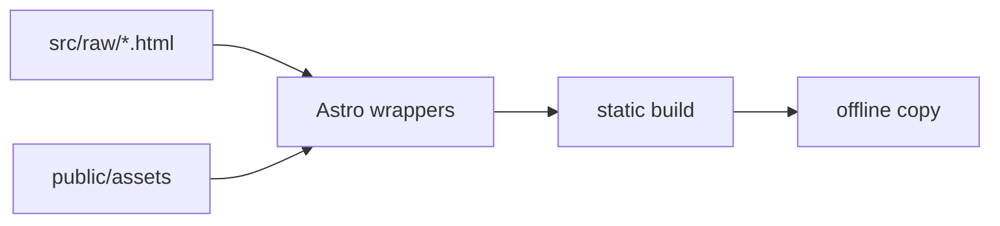

<div align="center">

# Survival Field Guide

**A survival reference built to work when nothing else does.**

[](https://adineo-cmd.github.io/survival-field-guide/)
   

[](https://github.com/adineo-cmd/survival-field-guide/stargazers) [](https://github.com/adineo-cmd/survival-field-guide/commits)

[Live site](https://adineo-cmd.github.io/survival-field-guide/) · [Quick start](#quick-start) · [How it works](#how-it-works) · [Features](#features)

</div>

---

A multi-page field guide covering the Rule of Threes, shelter, water, fire,
first aid, navigation, signaling, bushcraft, cold weather, food, plants,
knots, gear and a self-quiz.

Pure static, no external requests and no tracking. Save it to a device and it
keeps working offline.

## Features

| | Feature | What it does |
| --- | --- | --- |
| 3️⃣ | **Rule of Threes** | The priority order that decides what to do first. |
| 🔥 | **Core survival** | Shelter, water, fire, first aid and signaling, each on its own page. |
| 🧭 | **Navigation and bushcraft** | Without a phone, a signal or a map server. |
| ❓ | **Self-quiz** | Checks recall before you need it in the field. |

## How it works

The content is authored as plain HTML and wrapped by Astro:

1. `src/raw/*.html` holds the editable pages.
2. `src/pages/*.astro` wraps each one in the shared field-guide layout.
3. `tools/` builds the combined offline-friendly output.
4. The build has no external requests, so the deployed site is self-contained.



## Quick start

**Install and run**

```bash
npm install
npm run dev
```

**Production build**

```bash
npm run build
npm run preview
```

## Project structure

```text
src/raw/       editable HTML pages
src/pages/     Astro wrappers and routes
public/assets/ styles, fonts and static assets
tools/         content build helpers
```

## Deployment

Every push to `main` builds the site and deploys it to GitHub Pages
through `.github/workflows/deploy.yml`:

**https://adineo-cmd.github.io/survival-field-guide/**

The output is fully static — no server, no database, no runtime environment
variables.

## Offline use

The site is plain HTML, CSS and JavaScript. After the first load it makes no
external requests, so saving the deployed pages (or the `dist/` folder) is
enough to keep the guide with you.
